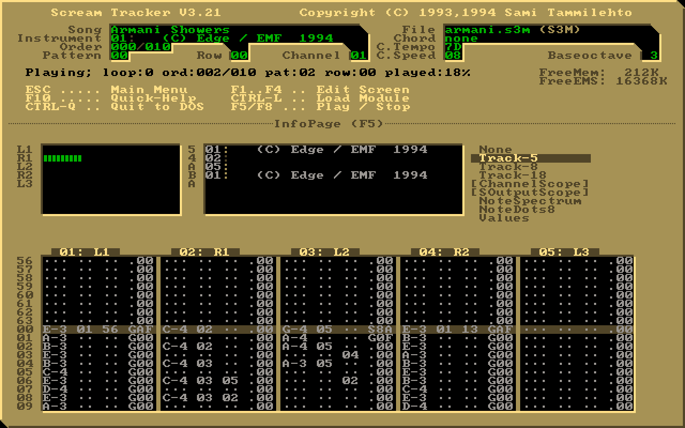

# Scream Tracker 3, on a modern Linux terminal

Scream Tracker 3 is a music tracker written in 1993–94 by Sami Tammilehto (Psi) of Future Crew. A generation
of musicians learned to make music with it on DOS PCs, and its S3M format became one of the classics of the
demoscene. This project exists out of deep respect for that tool.

The goal is simple: run the **real** Scream Tracker 3.21 on a modern computer, unchanged and pixel-exact, as it
looked and sounded on a 486. No remake and no reinterpretation. Just the original, made usable again.



## How it works

`st3` is a single Linux program. Inside it is the original ST3 executable, unpacked from its 1994 copy
protection and compression, running on a small emulated PC built just for it:

- a 386 CPU, a VGA card, a Sound Blaster Pro with its AdLib FM chip, 16 MB of EMS memory, BIOS and DOS
- the screen is drawn in your terminal: pixel-exact if the terminal can show sixel graphics, colored text otherwise
- sound goes to PipeWire or PulseAudio

ST3's own code does everything else, so every menu, key and quirk behaves as it did in 1994.

## Try it

```sh
cd dist && ./st3
```

Your terminal needs at least 80×50 characters. See [dist/README.txt](dist/README.txt) for keys, options and
tips. Laptop F-keys, for example, also work through `Ctrl-F` then `1`…`0`.

To rebuild it you need gcc, the static zlib library and Python 3: `make -C st3emu st3`.

## Who made this

The reverse engineering, emulator, graphics, audio and tests were written by **Claude** (Anthropic's AI), working
in Claude Code. The project owner provided the direction, guidance and testing on real hardware, and the stubbornness to
insist on being faithful to the original.

The journey, including every dead end, is written down in [notes/JOURNAL.md](notes/JOURNAL.md).

## Credits and license

- **Scream Tracker 3.21** © 1993–94 Sami Tammilehto / Future Crew. It is freeware: "THIS PROGRAM IS FREEWARE AND
  CAN BE FREELY DISTRIBUTED AS LONG AS NO PAYMENT IS INVOLVED". Its files are included here on those terms.
- The example songs and instruments belong to their authors.
- Everything new in this repository (the emulator, tools and documentation) is released into the **public
  domain** under the [Unlicense](UNLICENSE). Do whatever you like with it.
